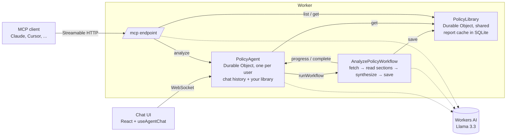

# Privacy Lens

Privacy Lens reads a website's privacy policy and tells you, in plain language, what the company collects, who it shares your data with, how long it keeps it, and what you can do about it. Every report has a 1–10 risk score and highlights the exact clauses that drive it, and each quote is checked against the original page so you know which ones to trust.

You can use it two ways: chat with it in the browser, or connect any MCP client (Claude, Cursor, your own agent) to its MCP server and query the same reports from there.

**Live demo:** `https://cf-ai-privacy-lens.<your-subdomain>.workers.dev` *(replace after deploying)*

> Privacy Lens summarizes documents. It is not legal advice.

## How it meets the assignment

| Requirement | What this project uses |
|---|---|
| LLM | Llama 3.3 70B (`@cf/meta/llama-3.3-70b-instruct-fp8-fast`) on Workers AI, for chat with tool calling and for JSON-mode extraction |
| Workflow / coordination | A Cloudflare **Workflow** (`AnalyzePolicyWorkflow`) runs the multi-step analysis; **Durable Objects** (via the Agents SDK) coordinate chat, jobs, and the shared library |
| User input | A React chat UI served from Workers static assets, talking to the agent over WebSockets (`useAgentChat`), plus an **MCP endpoint** for other AI tools |
| Memory / state | Per-user chat history and policy library in the agent's SQLite (synced live to the UI), and a shared report cache in a second Durable Object |

## Architecture



### What happens when you paste a link

1. The **PolicyAgent** (your personal Durable Object) receives the message and Llama 3.3 calls the `analyze_policy` tool.
2. The tool normalizes the URL and checks the **PolicyLibrary**. If the policy was analyzed in the last 30 days, the report comes back immediately.
3. Otherwise the agent starts an **AnalyzePolicyWorkflow** and replies right away, so the chat never blocks.
4. The Workflow fetches the page, converts it to text, splits it into sections, and extracts findings from each section with a separate LLM call. Each section is its own durable step.
5. A final step merges the findings into one report, then checks every quote against the page text and marks it verified or not.
6. The report is saved to the library. The agent receives the completion callback, adds the policy to your sidebar, and posts the result in the chat.

Progress updates stream to the sidebar the whole time through the agent's synced state.

## Design decisions

**Why a Workflow for analysis.** A long policy needs 10 or more LLM calls and can take over a minute. Doing that inside one chat turn would block the conversation and lose all the work if anything failed. Because each section is a separate durable step, a failure in section 9 retries from section 9, not from the beginning. Failures that retrying can't fix, such as a 404 or a JavaScript-only page, use `NonRetryableError` so they fail fast with a clear message.

**Why two kinds of Durable Object.** A policy says the same thing for everyone, so the analysis is cached once in a shared `PolicyLibrary` and reused by every user and every MCP client. What's personal, your chat and which policies you've looked at, lives in your own `PolicyAgent`. This avoids paying for the same analysis twice and keeps user data isolated.

**Why map-reduce over the policy.** Long policies don't fit comfortably in one prompt, and models skim when they do. Extracting per section and then synthesizing keeps each call focused. The merged findings are deduplicated in code before the final call, which keeps that prompt small.

**Why verify quotes.** LLMs paraphrase and sometimes invent quotes. In a legal document that matters, so every red-flag quote is matched against the fetched text and labelled. The chat model is instructed to say when a quote could not be matched.

**Why MCP.** The reports are useful to other agents too, for example a coding assistant checking a vendor before integrating it. Exposing them over MCP takes one extra file, and it reuses the same library and the same analysis path.

**Safety basics.** URLs are validated and private-network addresses are rejected before anything is fetched. The shared library's public route is blocked, so it's only reachable through internal RPC. The MCP endpoint can be protected with a bearer token.

## Run it locally

Requirements: Node.js 20 or later and a Cloudflare account (Workers AI runs remotely, even in local development).

```bash
git clone https://github.com/<you>/cf_ai_privacy-lens.git
cd cf_ai_privacy-lens
npm install
npx wrangler login
npm run types     # generates worker-configuration.d.ts from wrangler.jsonc
npm run dev
```

Open the URL Vite prints (usually http://localhost:5173) and paste a privacy policy link, for example `https://www.cloudflare.com/privacypolicy/`.

To check types: `npm run typecheck`.

## Deploy

```bash
npm run deploy
```

This builds the UI and the Worker and deploys both. Optionally protect the MCP endpoint:

```bash
npx wrangler secret put MCP_TOKEN
```

## Connect an MCP client

The endpoint is `https://<your-worker>/mcp` (Streamable HTTP). It exposes four tools:

| Tool | What it does |
|---|---|
| `list_analyzed_policies` | Lists analyzed policies with risk scores |
| `get_policy_report` | Returns the full report for a URL or report id |
| `ask_about_policy` | Answers a question using only the stored report |
| `analyze_policy` | Starts a new analysis, or returns a recent report |

**Claude Code**

```bash
claude mcp add --transport http privacy-lens https://<your-worker>/mcp
# with a token:
claude mcp add --transport http privacy-lens https://<your-worker>/mcp \
  --header "Authorization: Bearer <MCP_TOKEN>"
```

**MCP Inspector** (good for a quick test)

```bash
npx @modelcontextprotocol/inspector
```

Choose Streamable HTTP and enter the endpoint URL.

## Project structure

```
src/
  server.ts      Worker entry: routes /mcp, agent WebSockets, blocks internal routes
  agent.ts       PolicyAgent: chat, tools, per-user memory, workflow callbacks
  workflow.ts    AnalyzePolicyWorkflow: the durable analysis pipeline
  library.ts     PolicyLibrary: shared report cache (SQLite)
  mcp.ts         MCP server and its tools
  analysis.ts    URL checks, HTML to text, chunking, prompts, quote verification
  shared.ts      Types shared by the Worker and the UI
  client/        React chat UI
wrangler.jsonc   Bindings: Workers AI, Durable Objects, Workflow, assets
PROMPTS.md       AI prompts used to build this project
```

## Limitations and next steps

- **JavaScript-rendered pages.** Some policies only appear after JavaScript runs. Using Browser Rendering in the fetch step would handle them.
- **One shared library object.** A single Durable Object is simple and fast at this scale, but every lookup goes through it. At larger scale I'd shard by URL hash or move reports to D1.
- **Identity.** Users are identified by a random id stored in the browser, which is fine for a demo. A real deployment would add sign-in, and OAuth on the MCP endpoint using `workers-oauth-provider` instead of a shared token.
- **Semantic search.** Storing section embeddings in Vectorize would let the agent answer questions the report doesn't cover by retrieving the original text.
- **Policy changes.** A scheduled re-check could compare a new version of a policy against the stored one and report what changed.
